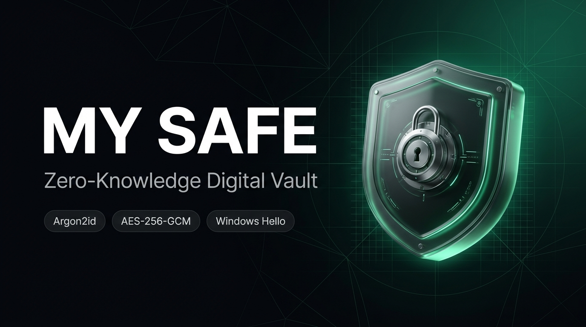
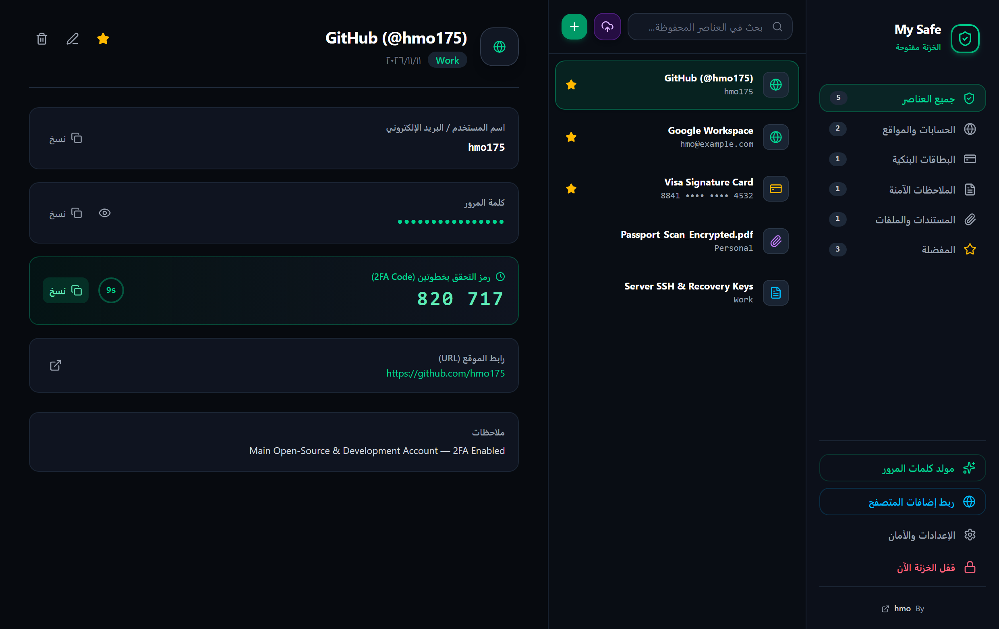
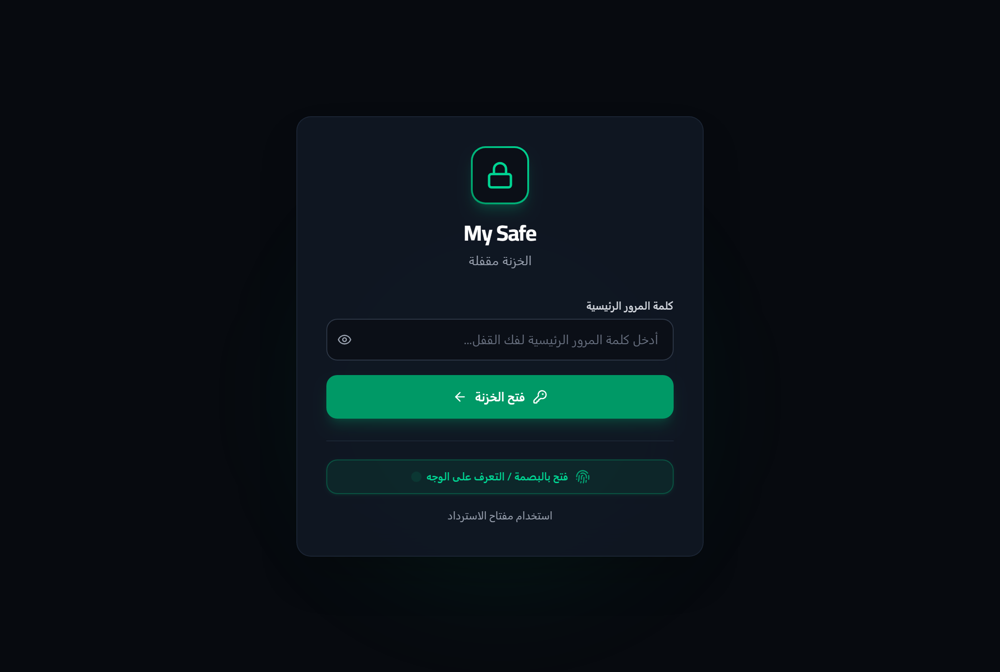
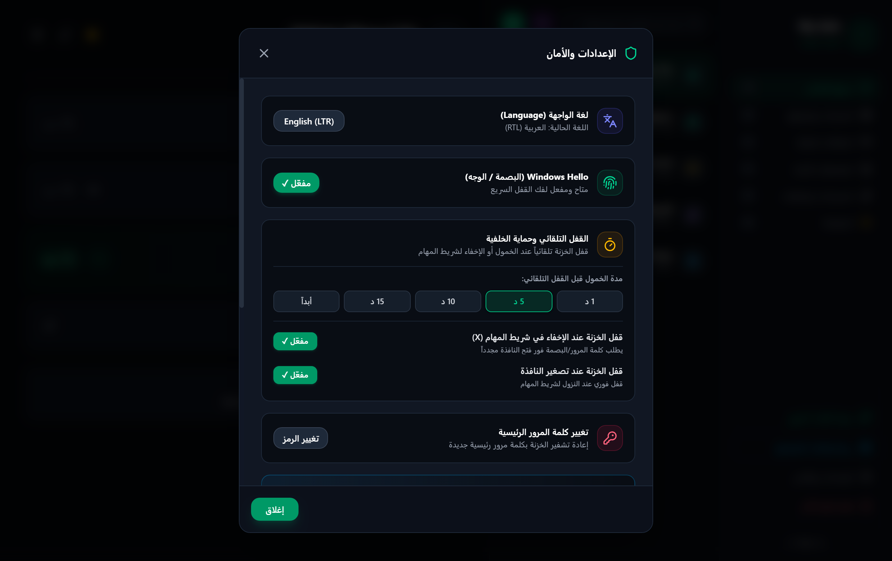
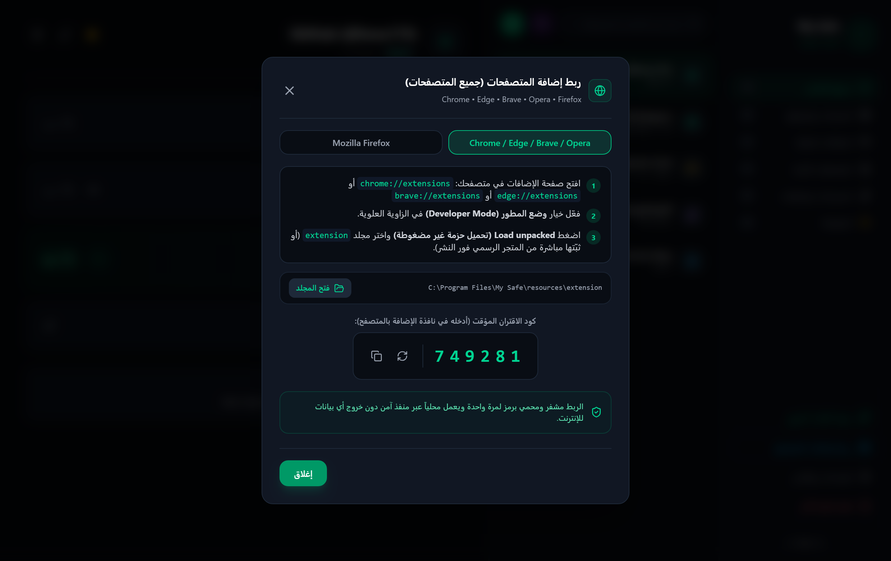
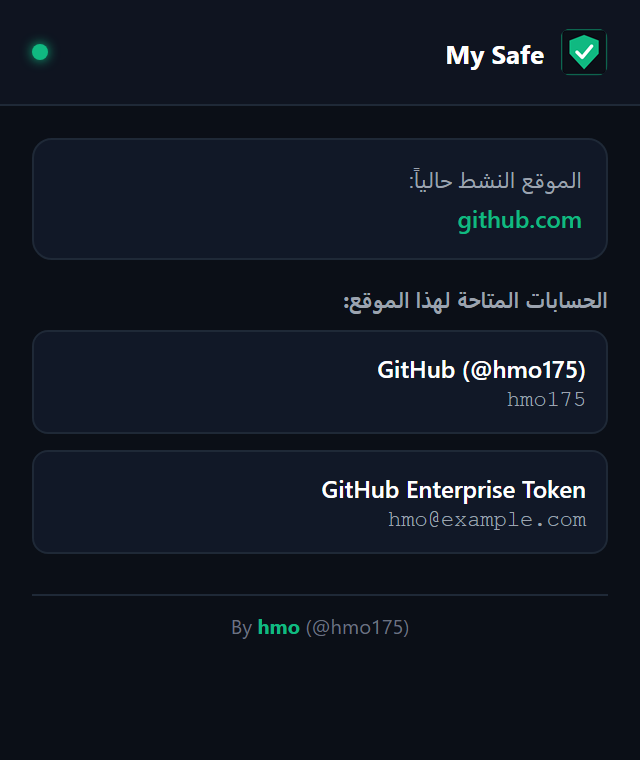

<div align="center">



<br/><br/>

# 🛡️ My Safe — الخزنة الرقمية فائقة الأمان
### Zero-Knowledge Desktop Password Manager, Encrypted File Vault & Cross-Browser Autofill

[](https://github.com/hmo175/my-safe)
[](https://github.com/hmo175/my-safe)
[](https://github.com/hmo175/my-safe)
[](https://github.com/hmo175/my-safe)

<br/>

**Designed & Engineered by [hmo](https://github.com/hmo175) (`@hmo175`)**

[📥 Download Installer](#-التحميل-والتشغيل-download--install) • [📸 Screenshots](#-معرض-صور-التطبيق-screenshots) • [🔐 Security](#-الأمان-والتشفير-security-architecture) • [🌐 Extensions](#-إضافة-المتصفحات-browser-extensions) • [📜 Privacy Policy](PRIVACY_POLICY.md)

</div>

---

## 🌟 نبذة عن المشروع | About My Safe

**My Safe** هو تطبيق سطح مكتب متكامل وعالي الأمان لإدارة كلمات المرور، البطاقات البنكية، الملاحظات السرية، وحفظ المستندات الحساسة (PDF & Images) بتشفير محلي 100% وفق مبدأ **المعرفة الصفرية (Zero-Knowledge)**.

**My Safe** is a local-first, zero-knowledge digital vault for Windows 10/11 built with **Electron, React, TypeScript & Tailwind CSS**. All encryption happens strictly offline on your machine using **Argon2id** + **AES-256-GCM**, paired with native **Windows Hello** biometrics, a live **2FA (TOTP)** authenticator, an in-memory **RAM File Viewer**, and a **Manifest V3** browser extension for Chrome, Edge, Brave, Opera, Vivaldi, and Mozilla Firefox.

---

## 📸 معرض صور التطبيق | Screenshots

### 🖥️ لوحة التحكم الرئيسية ومولّد رموز التحقق (2FA Live Vault Dashboard)
<div align="center">
  
</div>

<br/>

<table>
  <tr>
    <td width="50%" align="center">
      <b>🖐️ قفل البصمة (Windows Hello Biometrics)</b><br/><br/>
      
    </td>
    <td width="50%" align="center">
      <b>⚙️ الإعدادات والقفل التلقائي (Auto-Lock & Security)</b><br/><br/>
      
    </td>
  </tr>
  <tr>
    <td width="50%" align="center">
      <b>🌐 ربط جميع المتصفحات (Multi-Browser Pairing)</b><br/><br/>
      
    </td>
    <td width="50%" align="center">
      <b>🧩 نافذة إضافة المتصفح (Extension Popup)</b><br/><br/>
      
    </td>
  </tr>
</table>

---

## 🚀 الميزات الرئيسية | Key Features

* **🔐 تشفير عسكري معتمد (Zero-Knowledge Cryptography):**
  * اشتقاق المفاتيح بخوارزمية **Argon2id** (`64 MB` memory cost, `3` iterations, `4` parallelism) المقاومة لهجمات GPU وASIC.
  * تشفير جميع السجلات والملفات والنسخ الاحتياطية بخوارزمية **AES-256-GCM** مع ختم سلامة (Auth Tag) يمنع التلاعب.
  * **مفتاح استرداد طارئ (32-Char Crockford Base32)** لاسترجاع الخزنة عند نسيان كلمة المرور الرئيسية.
  * إمكانية تغيير كلمة المرور الرئيسية مع إعادة تشفير الخزنة بالكامل بملح جديد.

* **🖐️ المصادقة البيومترية (Native Windows Hello):**
  * تكامل مباشر مع واجهات **WinRT (`UserConsentVerifier`)** لبصمة الإصبع، التعرف على الوجه، أو رمز Windows PIN.
  * تفعيل ذكي تلقائي وتأكيد فوري عند فك قفل الخزنة.

* **🛡️ الحماية الذكية والقفل التلقائي (Smart Auto-Lock & Tray Service):**
  * **بقاء في الخلفية:** تصغير أنيق لصينية النظام بجانب ساعة الويندوز لخدمة المتصفح باستمرار دون إزعاج.
  * **قفل تلقائي بعد 5 دقائق خمول** (قابل للتخصيص: `1 / 5 / 10 / 15 دقيقة`).
  * **قفل فوري** عند الإغلاق إلى الخلفية `(X)`، تصغير النافذة، قفل شاشة الويندوز (`Win + L`)، أو وضع السكون (`Sleep`).
  * **مسح تلقائي للحافظة** بعد 30 ثانية من نسخ أي كلمة مرور.

* **🌐 إضافة متصفحات متوافقة بالكامل (All Major Browsers — Manifest V3):**
  * متوافقة مع **Google Chrome, Microsoft Edge, Brave, Opera, Vivaldi, Mozilla Firefox**.
  * كشف ذكي لحقول تسجيل الدخول وظهور أيقونة الدرع داخل الحقل للتعبئة بنقرة واحدة.
  * **نافذة تأكيد أمان إلزامية** على سطح المكتب قبل إرسال أي كلمة مرور للمتصفح.
  * **الحفظ التلقائي (Auto-Save Banner)** عند تسجيل الدخول أو إنشاء حساب جديد.

* **📂 خزنة الملفات وعارض المستندات السري (In-Memory RAM Viewer):**
  * تشفير ملفات PDF، الجوازات، العقود، والصور وحفظها مشفرة على القرص.
  * فك التشفير وعرض الملفات **داخل الذاكرة العشوائية (RAM) فقط** دون كتابة أي نسخة مكشوفة على القرص الصلب.

* **⚡ أدوات احترافية مدمجة:**
  * **مولّد أكواد 2FA / TOTP** دوار كل 30 ثانية مع عداد حي.
  * **مولّد كلمات مرور قوية** مع قياس القوة وتخصيص الخانات.
  * **نقل البيانات بضغطة زر:** استيراد فوري لكلمات المرور من **Chrome / Edge / Bitwarden (CSV)** + تصدير نسخ احتياطية مشفرة `.mysafe`.
  * **واجهة ثنائية اللغة:** دعم كامل للعربية (**RTL**) والإنجليزية (**LTR**).

---

## 🧱 البنية التقنية | Tech Stack

| Layer | Technology |
| :--- | :--- |
| **Desktop Shell** | Electron v45 (Node.js, ContextBridge, `powerMonitor`, Tray) |
| **Frontend UI** | React 19, TypeScript, Tailwind CSS v4, Lucide Icons |
| **Cryptography** | `hash-wasm` (Argon2id), Node `crypto` AES-256-GCM, Scrypt |
| **Biometrics** | Native Windows Runtime (`UserConsentVerifier`) |
| **Browser Extensions** | Manifest V3 (`extension/` Chromium & `extension-firefox/` AMO) |

---

## 📥 التحميل والتشغيل | Download & Install

### للمستخدمين النهائيين (تثبيت مباشر بدون متطلبات):
1. حمّل ملف التثبيت **`My Safe Setup 1.0.0.exe`** من قسم [**Releases**](https://github.com/hmo175/my-safe/releases).
2. شغّل المثبّت لتنزيل البرنامج مع اختصار رسمي على سطح المكتب وقائمة ابدأ.
3. لتفعيل إضافة المتصفح، افتح **"ربط إضافات المتصفح"** داخل البرنامج واتبع الخطوات الموضحة بالداخل.

### للمطورين (التشغيل من الكود المصدري):
```bash
# 1. استنساخ المستودع
git clone https://github.com/hmo175/my-safe.git
cd my-safe

# 2. تثبيت الحزم
npm install

# 3. بناء التطبيق وحزم إضافات المتصفح
npm run build
npm run build:extensions

# 4. تشغيل التطبيق
npm start
# أو لتوليد ملف التثبيت exe:
npm run dist
```

---

## 🌐 إضافة المتصفحات | Browser Extensions

* مجلد **Chrome / Edge / Brave / Opera / Vivaldi:** [`extension/`](extension)
* مجلد **Mozilla Firefox:** [`extension-firefox/`](extension-firefox)
* سياسة الخصوصية: [`PRIVACY_POLICY.md`](PRIVACY_POLICY.md)
* دليل النشر في متاجر المتصفحات: [`STORE_PUBLISHING_GUIDE.md`](STORE_PUBLISHING_GUIDE.md)

---

## 👤 المطور وحقوق الملكية | Author & Credits

تم تصميم وهندسة وتطوير هذا المشروع بواسطة:

### **hmo**
* **GitHub:** [@hmo175](https://github.com/hmo175)
* **Repository:** [https://github.com/hmo175/my-safe](https://github.com/hmo175/my-safe)

---

## 📄 الترخيص | License

هذا المشروع مرخص تحت رخصة **MIT License** — جميع الحقوق محفوظة © 2026 **hmo (@hmo175)**.
